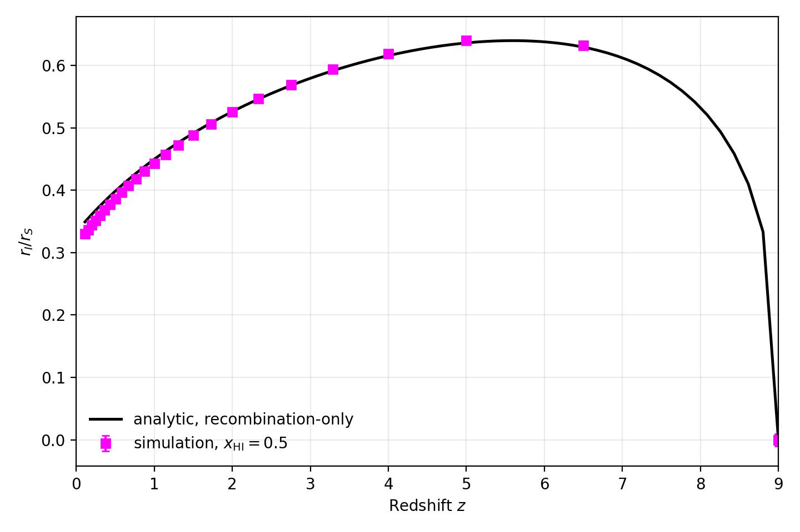

Cosmological Strömgren Sphere 1D
================================

The ``example/CosmologicalStromgrenSphere1D`` case follows a homogeneous,
constant-temperature, matter-dominated flat universe in spherical geometry.
The source switches on at ``z_i = 9`` and emits
``5e48 photons s^-1`` at ``13.6 eV``. Hydrogen contributes ten per cent of
the total matter density, with

* ``alpha_B = 2.59e-13 cm^3 s^-1``;
* ``beta = 3.1e-16 cm^3 s^-1``; and
* ``sigma_gamma_HI = 8.13e-18 cm^2``.

The gas temperature is held at ``1e4 K`` and the source is evolved with the
C²-Ray temporal scheme. The comoving spherical domain is 400 ckpc so that the
front remains inside the domain over the plotted interval.

The ionization-front radius is operationally defined by ``x_HI = 0.5``.
Magenta squares show the simulation result, with error bars equal to half the
local radial cell width divided by the instantaneous proper Strömgren radius.
The black line is the recombination-only cosmological analytic solution.

   Ionization-front radius divided by the instantaneous Strömgren radius as a
   function of redshift.

Run the example with:

.. code-block:: bash

   cd example/CosmologicalStromgrenSphere1D
   python cosmological_stromgren_sphere1d.py

The active chemistry coefficients must remain under ``par.chemistry`` in the
YAML configuration. Values placed only under ``example`` are plotting
metadata and are not consumed by the solver.
